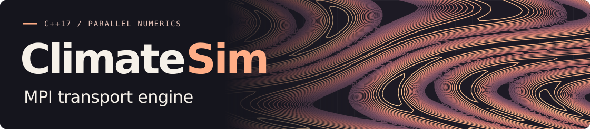
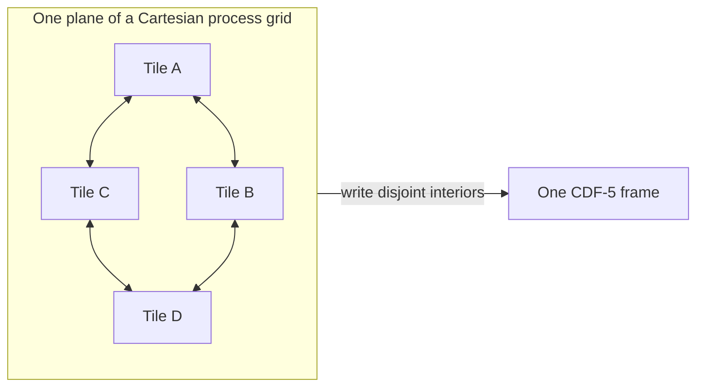
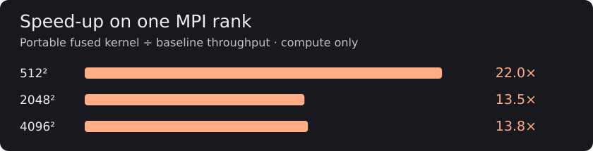
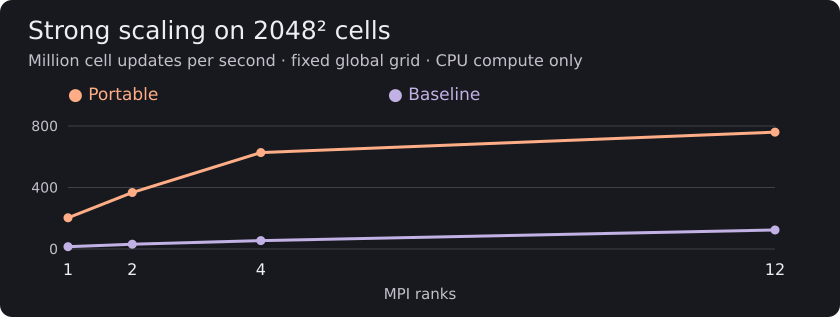
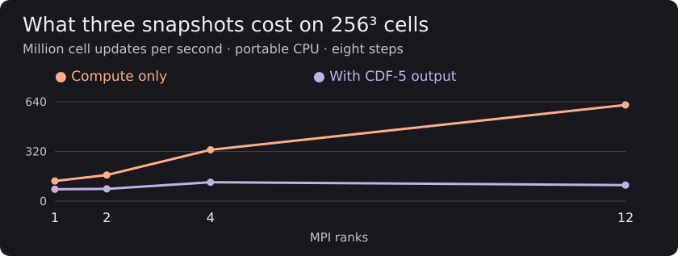

# 

**Follow a scalar field across a plane or through a volume, one MPI halo exchange at a time.**

[](https://github.com/antoniorizzoeng/climate-sim-mpi-cpp/actions/workflows/ci.yml)
[](https://github.com/antoniorizzoeng/climate-sim-mpi-cpp/actions/workflows/codeql.yml)
[](LICENSE)

<p align="center">
  
  <br/>
  <em>Periodic transport · 480 × 160 cells · two MPI ranks · magma</em>
</p>

## Why

Wind carries a pattern across a grid while diffusion softens its edges. Saving the initial field and the state after each output interval lets you measure both effects, even where the field crosses a rank boundary.

| The field | The flow |
| --- | --- |
| Start with a Gaussian hotspot, a zero field or a NetCDF array. A plane can seed every layer of a volume. | Use a uniform velocity or read cell-centred wind from NetCDF. The solver interpolates between records and holds the final wind. |
| **At the edges** · Pair periodic faces, fix a Dirichlet ghost value or copy the adjacent cell for zero-gradient Neumann faces. | **On disk** · Ranks write their tiles into one CDF-5 file with PnetCDF. An optional JSON file reports progress as frames arrive. |

## Quick start

From the checkout, use a C++17 compiler, CMake 3.16+, MPI, yaml-cpp and the PnetCDF development library. This Release build runs the supplied 512² hotspot on two ranks.

```sh
cmake -S . -B build -DCMAKE_BUILD_TYPE=Release -DBUILD_TESTING=OFF
cmake --build build --target climate_sim -j 4
mpirun -np 2 build/src/climate_sim --config=configs/dev.yaml \
  --steps=40 --out_every=10 --output=outputs/demo.nc --progress=outputs/progress.json
```

The final progress record reads `"step":40` and `"frames":5`. Frame zero is the initial field. The next four frames span simulation times 1 through 4. [File inputs, volume examples and Python plotting](docs/getting_started.md)

## How a cell advances

For the active axes $A$ (either $x,y$ or $x,y,z$), let $h_a$ be the cell spacing, $v_a$ the local wind component and $D_a$ the diffusivity. The horizontal axes share $D$ and the vertical axis can use a separate $D_z$.

$$
\frac{\partial u}{\partial t}+\sum_{a\in A}v_a\frac{\partial u}{\partial a}
=\sum_{a\in A} D_a\frac{\partial^2 u}{\partial a^2}.
$$

Forward Euler advances the field in time. A first-order upwind difference samples the neighbour on the incoming side of each axis. A centred second difference supplies diffusion. The fused CPU loop reads five points in a plane or seven in a volume, writes the next field and swaps buffers.

A sufficient bound for the combined update is

$$
\Delta t\sum_{a\in A}\left(\frac{|v_a|}{h_a}+\frac{2D_a}{h_a^2}\right)\leq 1.
$$

Runs with uniform wind clamp to this limit. File wind uses the maximum absolute speed of each component across all cells and records, and rejects an excessive step. [Discretisation and boundary conditions](docs/numerics.md)



Each arrow between tiles carries a one-cell face. In 3D there is another pair of neighbours along z. Periodic exchange proceeds in axis order so corners wrap correctly. [MPI layout and I/O](docs/architecture.md)

## Performance

On one Ryzen 5 8500G rank, the portable fused step delivered **13.5× to 22.0×** the baseline compute throughput across the three measured 2D sizes. At 512² on 12 ranks the ratio reached **23.8×**. These compare matched Release builds against `a21818f`.



<details>
<summary><strong>Rank scaling and the cost of writing a volume</strong></summary>





Both tests ran on one six-core, twelve-thread host. Each point is a median of three fresh jobs. The volume output test wrote 384 MiB in eight steps, including the initial and final frames. Startup and file creation are outside the timed interval.

</details>

The optional Kokkos backend targets CUDA, HIP and OpenMP. CPU parity and Kokkos OpenMP throughput are documented. **GPU throughput has not been measured.** [Benchmark tables and reproduction](docs/performance.md) · [Chart generator](scripts/readme_charts.py) · [Kokkos builds](docs/getting_started.md#gpu-builds)

## Sky nowcast

The Sky application uses this solver three times, once for each cloud layer. The API supplies Open-Meteo cloud cover and hourly winds, then blends transported cover at the observing site with the model forecast. The transport weight decays with a two-hour default time constant. The observing window also uses a jet-wind seeing estimate. Cloud formation, dissipation and local turbulence limit that interpretation. Only site and surrounding grid coordinates are used as location data in the weather request. [Sky method and observing window](https://github.com/antoniorizzoeng/climate-sim-backend#sky-nowcast)

<details>
<summary><strong>Configuration reference</strong></summary>

| YAML | Meaning |
| --- | --- |
| `grid.nx, ny, nz` · `dx, dy, dz` | Cell counts and spacings. A single layer selects the 2D solver. |
| `physics.D, Dz` · `vx, vy, vz` | Horizontal and vertical diffusivity and uniform velocity. `Dz` defaults to `D`. |
| `time.dt, steps, out_every` | Timestep, update count and snapshot cadence. The final state is always written. |
| `bc` | One boundary type or a mapping of faces. Opposite periodic faces must agree. |
| `ic.mode, path, var` · `wind.mode, path, interval` | Classic NetCDF initial conditions and steady or time-varying winds. |
| `output.path, progress` | Snapshot file and optional atomically replaced progress file. |
| `--backend=kokkos` | Select the device step in a Kokkos-enabled build. Native CPU is the default. |

[Example configuration](configs/dev.yaml) · [Full setup guide](docs/getting_started.md)

</details>

## Project family

**MPI engine** (here) · [Simulation API](https://github.com/antoniorizzoeng/climate-sim-backend) · [Browser workspace](https://github.com/antoniorizzoeng/climate-sim-frontend)

## Contributing

For numerical changes, include the grid, timestep, boundary conditions and MPI rank count so another contributor can reproduce the result. [Contributing guide](CONTRIBUTING.md)

## License

[GNU Affero General Public License v3.0](LICENSE)
