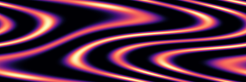
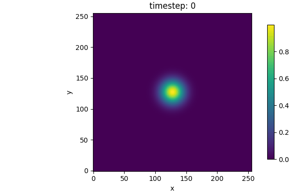

# Demo gallery

## Across a periodic seam

This 480 × 160 run used two MPI ranks, unit grid spacing, a uniform velocity of (1.55, 0.32), diffusivity 0.13 and a timestep of 0.4. After 230 steps, the backend exported the 30 saved frames in the magma colormap.

## A single hotspot

The hotspot makes the two terms easy to distinguish. Advection moves its centre and diffusion broadens its profile. [Run a hotspot locally](getting_started.md#run-a-demo)
